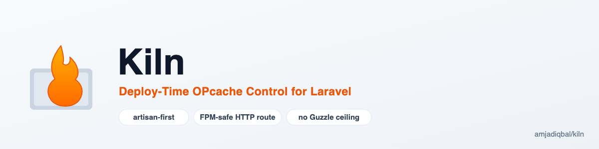

<p align="center">
  <picture>
    <source media="(prefers-color-scheme: dark)" srcset="art/banner-dark.png">
    
  </picture>
</p>

# Kiln: Deploy-Time OPcache Control for Laravel

Artisan commands (and an optional signed HTTP route) to clear, warm, and inspect PHP's OPcache
for Laravel apps deployed with `opcache.validate_timestamps=0` — the recommended production
setting under Octane, FrankenPHP, or any standard FPM deploy. Without invalidating OPcache on
every deploy, your app keeps serving stale bytecode until the process pool restarts.

[](https://packagist.org/packages/amjadiqbal/kiln)
[](https://packagist.org/packages/amjadiqbal/kiln)
[](LICENSE.md)

## Features

- `kiln:clear`, `kiln:warm`, `kiln:status`, `kiln:config` — four focused artisan commands, no bloat.
- A signed, POST-only HTTP route for the case artisan commands structurally can't cover: invalidating
  an FPM worker pool's shared OPcache from a CLI deploy script.
- Every signed URL is required to be temporary — a dedicated middleware refuses a permanent one
  even if it's otherwise valid, closing a real leaked-credential risk before it can happen.
- No HTTP client of its own: Kiln never calls out over HTTP (the optional route is served by your own app) and sets no
  Guzzle version constraint. Guzzle only comes in through Laravel's own `illuminate/http`, so Kiln can't hit the Guzzle
  version ceiling that blocks the older package below.
- PHP 8.3–8.5, Laravel 12 and 13, tested on every combination before each release (`scripts/ci-local.sh`).

## Why this exists

`appstract/laravel-opcache` did this job for years (about 137k downloads a month on Packagist), but its last release,
4.0.2, shipped in December 2020. It requires `guzzlehttp/guzzle: ^6.3.1|^7.0`, and a fresh Laravel 13 app ships Guzzle
8, so 4.0.2 cannot be installed there. A plain `composer require appstract/laravel-opcache` on Laravel 13 does not fail,
though: Composer quietly falls back to 2.0.5 (December 2019) plus `appstract/lush-http`, which Packagist lists as
abandoned. On Laravel 12 (Guzzle 7) 4.0.2 still installs.

Kiln is a from-scratch replacement for PHP 8.3+ and Laravel 12/13. It sets no Guzzle constraint of its own.

<sub>Checked in October 2026 on fresh `laravel/laravel` 12.70 and 13.38 apps with an empty Composer cache.</sub>

## The one thing you need to understand before using this

**A `php artisan` process and your FPM worker pool do not share the same OPcache.** Each PHP SAPI
process group gets its own OPcache shared-memory segment. Running `php artisan kiln:clear` over
SSH clears the *CLI's* OPcache — useful for confirming your config, but it does **not** touch the
bytecode your FPM workers are actually serving to real requests.

To invalidate OPcache for real traffic, the operation has to run *inside* a worker that shares
memory with the pool serving your site. That's what the HTTP route is for — see below.

## Installation

```bash
composer require amjadiqbal/kiln
```

Laravel's package auto-discovery registers the service provider automatically. Publish the config
if you want to change the warmed paths or enable the HTTP route:

```bash
php artisan vendor:publish --tag=kiln-config
```

## Artisan commands

```bash
php artisan kiln:clear     # opcache_reset() in this process
php artisan kiln:warm      # compile every file under config('kiln.warm_paths') into OPcache
php artisan kiln:status    # hit rate, memory usage, cached script count
php artisan kiln:config    # dump the relevant opcache.* ini directives, flag risky settings
```

`kiln:warm` compiles files with `opcache_compile_file()`, which **does not execute** the file's
top-level code — it's safe to run against `app/`, `config/`, and `routes/` without triggering
side effects, migrations, or route registration twice. Pass `--time-limit=<seconds>` to bound a
run (unlimited by default on the CLI):

```bash
php artisan kiln:warm --time-limit=15
```

`kiln:clear` and `kiln:warm` warn every time they run under the CLI SAPI, since that's the process whose
OPcache doesn't matter for production traffic. `kiln:status` warns only when OPcache is inactive in the CLI
(`opcache.enable_cli=0`). `kiln:config` doesn't warn about the SAPI; it only reads the ini settings.

## The HTTP route — for real FPM deploys

Enable it in `config/kiln.php` (or via `.env`):

```env
KILN_ROUTE_ENABLED=true
```

This registers three routes:

- `POST /kiln/opcache/clear`
- `POST /kiln/opcache/warm`
- `GET  /kiln/opcache/status`

`clear` and `warm` are state-changing, so they're POST-only — a GET request from a link
prefetcher, chat-app unfurler, security scanner, or corporate proxy can't trigger them by
accident. `status` is read-only and stays GET.

**Every route requires a TEMPORARY signed URL — never a permanent one.** Generate one with a
short expiry from your deploy script or a scheduled job:

```php
use Illuminate\Support\Facades\URL;

$url = URL::temporarySignedRoute('kiln.clear', now()->addMinutes(5));
```

Then, from your deploy script:

```bash
url=$(php artisan tinker --execute="echo URL::temporarySignedRoute('kiln.clear', now()->addMinutes(5));")
curl -fsS -X POST "$url"
```

**Do not use `URL::signedRoute()` (no expiry) for this.** A signature with no `expires`
parameter is a *permanent* credential that stays valid until you rotate `APP_KEY` — exactly the
kind of thing that ends up in a deploy log, shell history, or `ps` output. If it leaks, it's a
standing, unauthenticated remote OPcache-reset endpoint, and repeated resets on a busy app force
a full bytecode recompilation storm — a genuine DoS, not a theoretical one. Kiln's own
`RequireTemporarySignature` middleware rejects any otherwise-valid signature that has no
`expires` parameter, so a permanent URL is refused even if one gets generated by mistake.

Hitting `clear` once resets the shared OPcache segment for every worker in that pool — this is
standard Zend OPcache shared-memory behaviour, not something Kiln does itself; the route exists
purely so the reset happens *inside* an FPM worker instead of a separate CLI process.

`warm` is bounded by `kiln.warm_time_limit` (20 seconds by default) so a large recursive walk
can't pin an FPM worker for its entire duration — on a small pool that would be an outage. If the
limit is hit, the response reports `"timed_out": true` with whatever partial progress it made;
run it again to continue, or raise the limit.

### Troubleshooting: every call gets "403 Invalid signature", but the URL and `APP_KEY` are correct

This almost always means the app isn't seeing the same public scheme/host that the URL was
signed against — typically a reverse proxy (CloudPanel/nginx, Cloudflare, or similar) terminating
TLS and forwarding the request internally over plain HTTP without `TrustProxies` configured to
read `X-Forwarded-Proto`/`X-Forwarded-Host`. Laravel's own signature check recomputes the full
`scheme://host` from the request it actually receives; if that differs from what the URL was
signed against, the HMAC will never match, no matter how correct `APP_KEY` and the URL are.

Fix `TrustProxies` first if you can — it fixes every other absolute-URL-dependent thing in Laravel
too, not just this. If that's not available to you, set:

```env
KILN_ABSOLUTE_SIGNATURE=false
```

and generate every URL with `absolute: false` too — **the flag must match on both ends**, since
it's baked into the signature itself, not just how it's checked:

```php
URL::temporarySignedRoute('kiln.clear', now()->addMinutes(5), [], absolute: false)
```

## Configuration

```php
// config/kiln.php
return [
    'warm_paths' => ['app', 'bootstrap/cache', 'config', 'routes'],
    'warm_vendor' => false,
    'warm_time_limit' => env('KILN_WARM_TIME_LIMIT', 20),
    'route' => [
        'enabled' => env('KILN_ROUTE_ENABLED', false),
        'prefix' => env('KILN_ROUTE_PREFIX', 'kiln'),
        'middleware' => [], // e.g. ['throttle:10,1']; don't add 'web' (its CSRF check rejects the POST with 419)
        'absolute_signature' => env('KILN_ABSOLUTE_SIGNATURE', true), // see Troubleshooting above
    ],
];
```

## Testing

```bash
composer test         # Pest, via Orchestra Testbench
composer pint         # Laravel Pint, --test mode
composer analyse      # Larastan/PHPStan
scripts/ci-local.sh   # PHP 8.3 / 8.4 / 8.5 x Laravel 12 / 13, the whole matrix
```

## Support

- 🐛 **Bug or feature request** — [open an issue](https://github.com/amjadiqbal/kiln/issues)
- 🔒 **Security issue** — please report privately via GitHub's security tab

## Need this customised, or something built?

I'm available for custom development, package integration, and technical consulting.

[](https://www.upwork.com/freelancers/amjadkhatri)

## More packages

Part of a family of open-source Laravel packages — see [all of them](https://github.com/amjadiqbal?tab=repositories).

| | |
|---|---|
| [laravel-logpulse](https://github.com/amjadiqbal/laravel-logpulse) | Proactive log health monitoring & intelligent alerting |
| [refresher](https://github.com/amjadiqbal/refresher) | Cache your test DB schema, skip `migrate:fresh` on every test run |
| [laralink](https://github.com/amjadiqbal/laralink) | Local-first package manager for Laravel |
| [laravel-tiptap](https://github.com/amjadiqbal/laravel-tiptap) | Tiptap editor with backend-driven config and secure uploads |
| [laravel-rough-notation](https://github.com/amjadiqbal/laravel-rough-notation) | Hand-drawn Rough Notation annotations for Blade/Livewire |

## Changelog

Please see [CHANGELOG.md](CHANGELOG.md) for details on what changed in each release.

## Contributing

Contributions, issues, and feature requests are welcome — see [open issues](https://github.com/amjadiqbal/kiln/issues)
or open a pull request.

## License

MIT. See [LICENSE.md](LICENSE.md).
